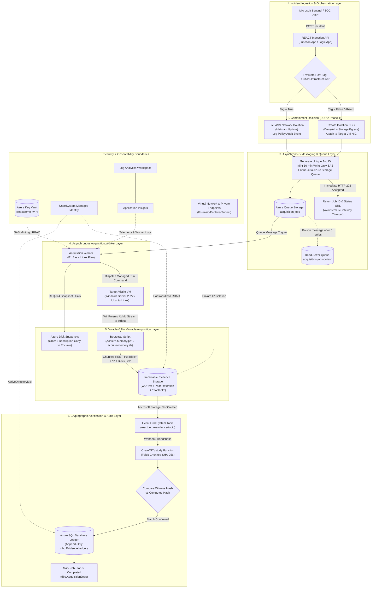

# REACT Live Azure Deployment & Demonstration Guide (Asynchronous Architecture)

> **⚠️ CRITICAL ENVIRONMENT NOTICE**:
> - **Subscription**: Azure for Students (`6b84f23e-bde5-4cc3-994b-786f988e4e7e`)
> - **Region**: `centralindia` (Central India)
> - **Hosting Plan**: Dedicated Linux App Service Plan (`B1` Basic tier, **EP1 Elastic Premium has 0 quota**)
> - **Existing Enclave Resource Group**: `rg-forensic-enclave` (DO NOT DELETE)
> - **Target Compromised Workload Group**: `Compromised-Environment-RG`
> - **Shell Compatibility**: All commands in this guide are authored specifically for **Windows PowerShell 5.1 / 7+**. Multiline commands use PowerShell backticks (`` ` ``) and `$env:VARIABLE` syntax. Linux VM bootstrap scripts are labeled explicitly.

---

## 1. Project Overview

**REACT** (Real-time Evidence Acquisition, Containment and Triage) is an automated cloud-native digital forensics and incident response (DFIR) platform. When a host is compromised, REACT autonomously executes containment, volatile memory acquisition, non-volatile disk snapshotting, evidence hashing, and cryptographic chain-of-custody tracking.

### Core Forensic Capabilities
1. **Real-time Containment**: Immediate isolation using dynamic Network Security Groups (NSGs) with default-deny rules while maintaining outbound egress exclusively to Azure Storage.
2. **Critical Infrastructure Policy**: Automated evaluation of the `Critical-Infrastructure=True` tag to bypass network disruption on mission-critical servers while proceeding with forensic acquisition.
3. **Live Physical Memory Acquisition**: Memory extraction from Windows hosts (via WinPmem) and Linux hosts (via AVML) streaming directly to cloud storage over Azure Compute Run Command without writing raw dump files to the compromised disk.
4. **Non-Volatile Disk Snapshots**: Coordinated managed disk snapshots copied cross-subscription into the isolated forensic enclave, gated on verified memory acquisition.
5. **WORM Storage & Legal Hold**: Time-based retention policies (7-year / 2,555 days) and active legal holds (`reacthold`) protecting evidence containers.
6. **Cryptographic Chain of Custody**: Chunked SHA-256 verification (matching host witness hashes) and immutable append-only records written to **Azure SQL Database Ledger**.
7. **Asynchronous Architecture**: Queue-backed job decoupling supporting long-running acquisitions up to 90 minutes (`5400s`) without HTTP gateway timeout disconnections.

---

## 2. Updated Architecture & Decoupled Execution Flow

The architecture operates on an **asynchronous job processing model**:

1. **Ingestion Layer**: Sentinel alerts or API calls invoke the response service (`POST /api/acquire`). The request is validated against schema contracts, target VM existence is confirmed, and a unique `jobId` is generated.
2. **Decoupled Messaging**: The acquisition job is enqueued into Azure Storage Queue (`acquisition-jobs`). The API returns HTTP `202 Accepted` immediately with a `statusUrl`, eliminating the Azure HTTP load balancer 230-second gateway timeout.
3. **Asynchronous Worker**: An acquisition worker on a dedicated Linux B1 App Service Plan pulls the job message, mints 60-minute write-only SAS tokens, and initiates the Managed Run Command on the target VM.
4. **Target Streaming via Put Block**: The bootstrap script on the victim host slices the raw tool output into 64 MB blocks, uploading each block via Azure Blob Storage `Put Block` REST calls and committing via `Put Block List`. No `memdump.raw` file is written to the victim's disk.
5. **Event Grid Hashing**: Blob creation triggers a `Microsoft.Storage.BlobCreated` event delivered via Event Grid system topic to the `ChainOfCustody` webhook.
6. **SQL Ledger Audit**: The webhook streams the blob in 8 MB chunks, calculates the server-side SHA-256 digest, compares it to the host witness hash, and appends an immutable row to `dbo.EvidenceLedger`.
7. **Job Completion & Status**: Orchestrators poll `GET /api/status?incidentId=<id>` or `GET /api/jobs/<jobId>` until status reports `Completed`.

---

## 3. Architecture & Containment Diagram



---

## 4. Resource Inventory: Preserved vs Incremental Resources

### A. Pre-Provisioned Resources (MUST BE PRESERVED — DO NOT DELETE)

| Resource Type | Resource Name | State / Purpose |
|---|---|---|
| **Storage Account** | `reactdemoencxuwxajwx` | Contains evidence containers (`evidence`, `memory-dumps`, `disk-snapshots`, `analysis-output`, `reports`, `tools`) and 7-year immutability policies. |
| **SQL Server** | `reactdemo-sql-xuwxajwx` | Azure AD-only authentication enabled. |
| **SQL Database** | `reactdemodfir` | Configured with `isLedgerOn: true`. |
| **Key Vault** | `reactdemo-kv-xuwxajwx` | Soft-delete and purge protection enabled. |
| **Event Grid Topic** | `reactdemo-evidence-topic` | System topic on `reactdemoencxuwxajwx`. |
| **Managed Identity** | `reactdemo-legalhold-xuwxajwx` | User-assigned identity for storage data actions. |
| **Virtual Network** | `reactdemo-vnet-xuwxajwx` | Contains `Forensic-Enclave-Subnet` (`10.250.0.0/24`) and `Function-Integration-Subnet` (`10.250.1.0/24`). |
| **Private Endpoint** | `reactdemoencxuwxajwx-blob-pe` | Blob private endpoint connected to `Forensic-Enclave-Subnet`. |
| **Private DNS Zone** | `privatelink.blob.core.windows.net` | Private DNS zone linked to enclave VNet. |

### B. Resources Provisioned Incrementally

| Resource Type | Resource Name | Architecture Change & Justification |
|---|---|---|
| **App Service Plan** | `reactdemo-plan-xuwxajwx` | **SKU changed from `EP1` to `B1` (Basic Linux)**. Overcomes student quota limit (EP1 = 0 limit) and preserves VNet integration into `Function-Integration-Subnet`. |
| **Function App** | `reactdemo-fn-xuwxajwx` | Linux Python 3.11 runtime hosting Ingestion API, Queue Worker, and Custody Webhook. |
| **Storage Queues** | `acquisition-jobs`, `acquisition-jobs-poison` | Created on `reactdemoencxuwxajwx` for asynchronous job processing and dead-letter poison handling. |
| **Log Analytics Workspace** | `reactdemo-law-xuwxajwx` | Provisioned under registered `Microsoft.OperationalInsights` (SKU: `PerGB2018`). |
| **Application Insights** | `reactdemo-ai-xuwxajwx` | Modern workspace-based Application Insights linked to `reactdemo-law-xuwxajwx`. |
| **Role Assignment** | `Storage Queue Data Contributor` | Grants Function App managed identity read/write access to queue storage. |

---

## 5. Prerequisites & Environment Setup

Run the following checks from an elevated **Windows PowerShell** terminal:

```powershell
# Verify Azure CLI version
az --version

# Verify Azure login
az account show --output table

# Set current active subscription
az account set --subscription "6b84f23e-bde5-4cc3-994b-786f988e4e7e"

# Confirm current context
$CurrentContext = az account show --output json | ConvertFrom-Json
Write-Host "Active Subscription: $($CurrentContext.name) ($($CurrentContext.id))"
Write-Host "Signed-in User: $($CurrentContext.user.name)"
```

---

## 6. Azure Subscription & Quota Checks

Verify compute and App Service quotas for `centralindia`:

```powershell
$Location = "centralindia"

# 1. Verify VM Quota (Standard Bsv2 family for victim VMs)
Write-Host "Checking VM family usage in $Location..."
az vm list-usage --location $Location --query "[?contains(name.value, 'standardBSv2Family') || contains(name.value, 'cores')].{Name:name.localizedValue, Current:currentValue, Limit:limit}" --output table

# 2. Check Standard_B2s_v2 availability in Zone 1 and Zone 2
Write-Host "Checking Standard_B2s_v2 SKU zone availability..."
az vm list-skus --location $Location --resource-type virtualMachines --size Standard_B2s_v2 --query "[].{Size:name, Zones:locationInfo[0].zones, Restrictions:restrictions}" --output json

# 3. Check App Service Basic B1 quota
Write-Host "Checking Web / App Service plan availability in $Location..."
az appservice list-plans --query "[?location=='$Location']" --output table
```

---

## 7. Resource Provider Registration Checks

Verify all necessary Azure Resource Providers are `Registered`:

```powershell
$RequiredProviders = @(
    "Microsoft.Compute",
    "Microsoft.Network",
    "Microsoft.Storage",
    "Microsoft.Sql",
    "Microsoft.KeyVault",
    "Microsoft.Web",
    "Microsoft.EventGrid",
    "Microsoft.OperationalInsights",
    "Microsoft.Insights"
)

foreach ($Provider in $RequiredProviders) {
    $State = az provider show --namespace $Provider --query "registrationState" --output tsv
    if ($State -eq "Registered") {
        Write-Host "[OK] Provider $Provider is Registered." -ForegroundColor Green
    } else {
        Write-Host "[WARNING] Provider $Provider is $State. Registering..." -ForegroundColor Yellow
        az provider register --namespace $Provider
    }
}
```

---

## 8. Environment Variables Setup (Set Once)

Copy and execute this block in Windows PowerShell:

```powershell
# ============================================================
# REACT ENVIRONMENT CONFIGURATION
# ============================================================
$env:SUB_ID = "6b84f23e-bde5-4cc3-994b-786f988e4e7e"
$env:MY_OBJECT_ID = "35b354e9-75b7-485e-9176-0529ae6c9411"
$env:MY_UPN = "bhavyaan.2005_gmail.com#EXT#@bhavyaan2005gmail.onmicrosoft.com"

# Resource Groups
$env:ENCLAVE_RG = "rg-forensic-enclave"
$env:TARGET_RG = "Compromised-Environment-RG"

# Regional Settings
$env:LOCATION = "centralindia"
$env:NAME_PREFIX = "reactdemo"

# Path Settings
$env:REPO_ROOT = "c:\BHAVYA\Acer I5\IT PERSONAL\NFSU (CSE)\SEM 7\PROJECT\code repository"

# Verification
Write-Host "=== Active Configuration ===" -ForegroundColor Cyan
Write-Host "Subscription:  $env:SUB_ID"
Write-Host "Enclave RG:    $env:ENCLAVE_RG"
Write-Host "Target RG:     $env:TARGET_RG"
Write-Host "Location:      $env:LOCATION"
Write-Host "Prefix:        $env:NAME_PREFIX"
Write-Host "Object ID:     $env:MY_OBJECT_ID"
```

---

## 9. Existing Resource Discovery & Safety Validation

Before running deployment commands, inspect existing resources in `rg-forensic-enclave` to ensure they are healthy:

```powershell
Write-Host "=== Inspecting Existing Resources in $env:ENCLAVE_RG ===" -ForegroundColor Cyan
az resource list --resource-group $env:ENCLAVE_RG --output table

# Verify Storage Account
$StorageAccounts = az storage account list --resource-group $env:ENCLAVE_RG --query "[].name" --output tsv
Write-Host "Found Storage Account(s): $StorageAccounts"

# Verify SQL Server
$SqlServers = az sql server list --resource-group $env:ENCLAVE_RG --query "[].name" --output tsv
Write-Host "Found SQL Server(s): $SqlServers"

# Verify Key Vault
$KeyVaults = az keyvault list --resource-group $env:ENCLAVE_RG --query "[].name" --output tsv
Write-Host "Found Key Vault(s): $KeyVaults"

# Verify VNet and Subnets
$Vnets = az network vnet list --resource-group $env:ENCLAVE_RG --query "[].name" --output tsv
Write-Host "Found VNet(s): $Vnets"
az network vnet subnet list --resource-group $env:ENCLAVE_RG --vnet-name "reactdemo-vnet-xuwxajwx" --output table
```

---

## 10. Bicep Template Build

Compile the Bicep template locally to ensure zero syntax or parameter errors:

```powershell
Set-Location $env:REPO_ROOT

# Compile Bicep to ARM JSON
az bicep build --file "iac/main.bicep" --outfile "iac/main.json"

if ($LASTEXITCODE -eq 0) {
    Write-Host "[SUCCESS] Bicep template compiled cleanly to iac/main.json" -ForegroundColor Green
} else {
    Write-Host "[ERROR] Bicep compilation failed." -ForegroundColor Red
    exit 1
}
```

---

## 11. What-If Deployment Preview

Run Azure Resource Manager What-If deployment preview. This lets you inspect changes before execution.

```powershell
Set-Location $env:REPO_ROOT

Write-Host "Running ARM What-If preview..." -ForegroundColor Cyan

az deployment group what-if `
  --resource-group $env:ENCLAVE_RG `
  --template-file "iac/main.bicep" `
  --parameters `
    "sqlAdminObjectId=$env:MY_OBJECT_ID" `
    "sqlAdminLogin=$env:MY_UPN" `
    "targetSubscriptionId=$env:SUB_ID" `
    "targetResourceGroup=$env:TARGET_RG" `
    "enableMockMode=false" `
    "location=$env:LOCATION" `
    "namePrefix=$env:NAME_PREFIX" `
    "hostingPlanSku=B1" `
    "hostingPlanTier=Basic" `
    "legalHoldTags=['reacthold']"
```

### Expected What-If Output Interpretation
- **`Create`**: App Service Plan (`reactdemo-plan-xuwxajwx`), Function App (`reactdemo-fn-xuwxajwx`), Storage Queues (`acquisition-jobs`, `acquisition-jobs-poison`), Log Analytics Workspace (`reactdemo-law-xuwxajwx`), Application Insights (`reactdemo-ai-xuwxajwx`), Role Assignments.
- **`Ignore` / `NoChange`**: Existing Storage Account (`reactdemoencxuwxajwx`), SQL Server, Database, Key Vault, VNet, Blob Private Endpoint.
- **`Delete`**: Must be **0**. If any delete operation is shown, halt immediately.

---

## 12. Incremental Deployment Execution

Execute the incremental deployment. This provisions the B1 hosting plan, function app, queue storage, and monitoring without replacing existing data resources.

```powershell
Set-Location $env:REPO_ROOT

Write-Host "Deploying incremental infrastructure to $env:ENCLAVE_RG..." -ForegroundColor Cyan

$DeploymentResult = az deployment group create `
  --resource-group $env:ENCLAVE_RG `
  --template-file "iac/main.bicep" `
  --parameters `
    "sqlAdminObjectId=$env:MY_OBJECT_ID" `
    "sqlAdminLogin=$env:MY_UPN" `
    "targetSubscriptionId=$env:SUB_ID" `
    "targetResourceGroup=$env:TARGET_RG" `
    "enableMockMode=false" `
    "location=$env:LOCATION" `
    "namePrefix=$env:NAME_PREFIX" `
    "hostingPlanSku=B1" `
    "hostingPlanTier=Basic" `
    "legalHoldTags=['reacthold']" `
  --output json | ConvertFrom-Json

# Export outputs to local variables
$env:STORAGE_ACCOUNT    = $DeploymentResult.properties.outputs.storageAccountName.value
$env:KEY_VAULT_URI      = $DeploymentResult.properties.outputs.keyVaultUri.value
$env:FUNC_APP_NAME      = $DeploymentResult.properties.outputs.functionAppName.value
$env:FUNC_HOST_NAME     = $DeploymentResult.properties.outputs.functionAppHostName.value
$env:FUNC_PRINCIPAL_ID  = $DeploymentResult.properties.outputs.functionPrincipalId.value
$env:SQL_SERVER_FQDN    = $DeploymentResult.properties.outputs.sqlServerFqdn.value
$env:SQL_DB_NAME        = $DeploymentResult.properties.outputs.sqlDatabaseName.value
$env:QUEUE_NAME         = $DeploymentResult.properties.outputs.acquisitionQueueName.value
$env:POISON_QUEUE_NAME  = $DeploymentResult.properties.outputs.acquisitionPoisonQueueName.value
$env:LAW_NAME           = $DeploymentResult.properties.outputs.logAnalyticsWorkspaceName.value

Write-Host "=== INCREMENTAL DEPLOYMENT SUCCEEDED ===" -ForegroundColor Green
Write-Host "Storage Account:     $env:STORAGE_ACCOUNT"
Write-Host "Key Vault URI:       $env:KEY_VAULT_URI"
Write-Host "Function App:        $env:FUNC_APP_NAME"
Write-Host "Function Host:       $env:FUNC_HOST_NAME"
Write-Host "Function Identity:   $env:FUNC_PRINCIPAL_ID"
Write-Host "SQL Server FQDN:     $env:SQL_SERVER_FQDN"
Write-Host "SQL Database:        $env:SQL_DB_NAME"
Write-Host "Acquisition Queue:   $env:QUEUE_NAME"
Write-Host "Poison Queue:        $env:POISON_QUEUE_NAME"
Write-Host "Log Analytics:       $env:LAW_NAME"
```

---

## 13. Managed Identity & Cross-Resource RBAC Configuration

Grant the Function App managed identity the required RBAC roles on the **target resource group** (where victim workloads reside):

```powershell
Write-Host "Configuring cross-resource RBAC on $env:TARGET_RG..." -ForegroundColor Cyan

# 1. Network Contributor (permits swapping isolation NSGs onto victim NICs)
az role assignment create `
  --assignee $env:FUNC_PRINCIPAL_ID `
  --role "Network Contributor" `
  --scope "/subscriptions/$env:SUB_ID/resourceGroups/$env:TARGET_RG"

# 2. Disk Snapshot Contributor (permits creating snapshots of victim OS & data disks)
az role assignment create `
  --assignee $env:FUNC_PRINCIPAL_ID `
  --role "Disk Snapshot Contributor" `
  --scope "/subscriptions/$env:SUB_ID/resourceGroups/$env:TARGET_RG"

# 3. Reader (permits reading target VM, storage profile, and NIC configurations)
az role assignment create `
  --assignee $env:FUNC_PRINCIPAL_ID `
  --role "Reader" `
  --scope "/subscriptions/$env:SUB_ID/resourceGroups/$env:TARGET_RG"

# Verify active role assignments
az role assignment list --assignee $env:FUNC_PRINCIPAL_ID --scope "/subscriptions/$env:SUB_ID/resourceGroups/$env:TARGET_RG" --output table

Write-Host "Waiting 60 seconds for Azure RBAC cache replication..." -ForegroundColor Yellow
Start-Sleep -Seconds 60
```

---

## 14. Victim VM Provisioning in Target Resource Group

Deploy the test victim VMs in `Compromised-Environment-RG`:
- **`web-01`**: Windows Server 2022 Datacenter in **Zone 1** (High-Severity Scenario).
- **`db-02`**: Ubuntu 22.04 LTS in **Zone 2** with `Critical-Infrastructure=True` tag (Policy Bypass Scenario).

```powershell
$AdminPasswordSecure = Read-Host -Prompt "Enter administrator password for victim VMs" -AsSecureString
$AdminPassword = [System.Net.NetworkCredential]::new("", $AdminPasswordSecure).Password

# 1. Deploy Windows Victim (web-01, Zone 1)
Write-Host "Deploying Windows victim VM (web-01) in Zone 1..." -ForegroundColor Cyan
az vm create `
  --resource-group $env:TARGET_RG `
  --name "web-01" `
  --image "Win2022Datacenter" `
  --size "Standard_B2s_v2" `
  --zone 1 `
  --admin-username "azureuser" `
  --admin-password $AdminPassword `
  --public-ip-sku "Standard" `
  --nsg-rule "RDP" `
  --location $env:LOCATION `
  --output none

# 2. Deploy Linux Victim (db-02, Zone 2 with Critical-Infrastructure tag)
Write-Host "Deploying Linux victim VM (db-02) in Zone 2 with Critical-Infrastructure tag..." -ForegroundColor Cyan
az vm create `
  --resource-group $env:TARGET_RG `
  --name "db-02" `
  --image "Ubuntu2204" `
  --size "Standard_B2s_v2" `
  --zone 2 `
  --admin-username "azureuser" `
  --admin-password $AdminPassword `
  --public-ip-sku "Standard" `
  --nsg-rule "SSH" `
  --location $env:LOCATION `
  --tags "Critical-Infrastructure=True" `
  --output none

# Discard password variable from memory
Remove-Variable AdminPassword

# Capture VM Resource IDs
$env:WEB01_ID = az vm show -g $env:TARGET_RG -n "web-01" --query "id" -o tsv
$env:DB02_ID  = az vm show -g $env:TARGET_RG -n "db-02" --query "id" -o tsv

Write-Host "web-01 Resource ID: $env:WEB01_ID"
Write-Host "db-02 Resource ID:  $env:DB02_ID"

# Validate Azure VM Run Command agent responsiveness
Write-Host "Validating VM Agent responsiveness via Run Command..." -ForegroundColor Cyan
az vm run-command invoke --ids $env:WEB01_ID --command-id RunPowerShellScript --scripts "Write-Host 'Windows Agent Healthy'"
az vm run-command invoke --ids $env:DB02_ID  --command-id RunShellScript      --scripts "echo 'Linux Agent Healthy'"
```

---

## 15. Forensic Acquisition Tool Preparation & Storage Upload

### The Reality of Forensic Tool Execution
> **FORENSIC SOUNDNESS REQUIREMENT**: Neither WinPmem nor AVML understands Azure Blob SAS tokens natively. WinPmem captures raw RAM and writes to stdout or local file; AVML writes to `/dev/stdout` or local file.  
> REACT uses custom bootstrap scripts (`Acquire-Memory.ps1` and `acquire-memory.sh` from `src/scripts/`) that read the raw binary stream from stdout in 64 MB chunks and upload each chunk using the Azure Blob REST API **Put Block** operation (`?comp=block&blockid=...`), committing the completed blocks with **Put Block List**. No dump file ever touches the victim host's disk.

Stage the verified binaries and scripts to the `tools` container:

```powershell
$ToolsStagingDir = Join-Path $env:TEMP "react-tools-upload"
New-Item -ItemType Directory -Path $ToolsStagingDir -Force | Out-Null

# 1. Download official WinPmem and AVML binaries
Write-Host "Downloading WinPmem and AVML..." -ForegroundColor Cyan
Invoke-WebRequest -Uri "https://github.com/velocidex/c-aff4/releases/download/v0.0.1/winpmem_mini.exe" `
  -OutFile (Join-Path $ToolsStagingDir "winpmem.exe")

Invoke-WebRequest -Uri "https://github.com/microsoft/avml/releases/download/v0.12.0/avml" `
  -OutFile (Join-Path $ToolsStagingDir "avml")

# 2. Copy repository streaming scripts
Copy-Item (Join-Path $env:REPO_ROOT "src\scripts\Acquire-Memory.ps1") -Destination $ToolsStagingDir
Copy-Item (Join-Path $env:REPO_ROOT "src\scripts\acquire-memory.sh")  -Destination $ToolsStagingDir

# 3. Upload to tools container in evidence storage account
Write-Host "Uploading binaries and scripts to '$env:STORAGE_ACCOUNT/tools'..." -ForegroundColor Cyan
$ToolFiles = @("winpmem.exe", "avml", "Acquire-Memory.ps1", "acquire-memory.sh")

foreach ($File in $ToolFiles) {
    az storage blob upload `
      --account-name $env:STORAGE_ACCOUNT `
      --container-name "tools" `
      --name $File `
      --file (Join-Path $ToolsStagingDir $File) `
      --auth-mode login `
      --overwrite `
      --output none
    Write-Host "  Uploaded: $File"
}

# Verify blob inventory
az storage blob list --account-name $env:STORAGE_ACCOUNT --container-name "tools" --auth-mode login --output table
```

---

## 16. Function App Code Deployment

Publish the Python Function App to Azure Functions on the B1 Linux plan:

```powershell
Set-Location (Join-Path $env:REPO_ROOT "src\functions")

Write-Host "Publishing Function App code to $env:FUNC_APP_NAME..." -ForegroundColor Cyan

# Publish using Azure Functions Core Tools
func azure functionapp publish $env:FUNC_APP_NAME --python --build remote

if ($LASTEXITCODE -eq 0) {
    Write-Host "[SUCCESS] Function App code successfully published." -ForegroundColor Green
} else {
    Write-Host "[ERROR] Function App deployment failed." -ForegroundColor Red
    exit 1
}

# 16.2 Activate Chain-of-Custody Event Grid Subscription
# Now that the Function App is running and can answer Event Grid's validation handshake,
# activate the chain-of-custody subscription.
Write-Host "Activating Event Grid Chain-of-Custody Subscription..." -ForegroundColor Cyan
Set-Location $env:REPO_ROOT

az deployment group create `
  --resource-group $env:ENCLAVE_RG `
  --template-file "iac/main.bicep" `
  --parameters `
    "sqlAdminObjectId=$env:MY_OBJECT_ID" `
    "sqlAdminLogin=$env:MY_UPN" `
    "targetSubscriptionId=$env:SUB_ID" `
    "targetResourceGroup=$env:TARGET_RG" `
    "enableMockMode=false" `
    "location=$env:LOCATION" `
    "namePrefix=$env:NAME_PREFIX" `
    "hostingPlanSku=B1" `
    "hostingPlanTier=Basic" `
    "legalHoldTags=['reacthold']" `
    "deployEventGridSubscription=true" `
  --output none

Write-Host "[SUCCESS] Chain-of-Custody Event Grid subscription activated." -ForegroundColor Green
```

---

## 17. Queue & Job Tracking Verification

Verify that the asynchronous acquisition queues are provisioned on `reactdemoencxuwxajwx`:

```powershell
Write-Host "Verifying Azure Queue Storage queues..." -ForegroundColor Cyan

# List queues
az storage queue list --account-name $env:STORAGE_ACCOUNT --auth-mode login --output table

# Verify acquisition-jobs queue metadata
az storage queue metadata show `
  --name "acquisition-jobs" `
  --account-name $env:STORAGE_ACCOUNT `
  --auth-mode login `
  --output json
```

---

## 18. SQL Ledger Schema Initialization

The ledger and tracking tables must exist in Azure SQL Database `reactdemodfir`.

Execute the DDL script `iac/scripts/init-sql-ledger.sql`:

```powershell
Set-Location $env:REPO_ROOT

# Read the SQL initialization script
$SqlScriptPath = Join-Path $env:REPO_ROOT "iac\scripts\init-sql-ledger.sql"

Write-Host "Initializing SQL Ledger tables in $env:SQL_DB_NAME on $env:SQL_SERVER_FQDN..." -ForegroundColor Cyan

# Option A: Execute via Azure CLI (requires user to be SQL Entra Admin)
az sql db execute `
  --resource-group $env:ENCLAVE_RG `
  --server ($env:SQL_SERVER_FQDN -split '\.')[0] `
  --name $env:SQL_DB_NAME `
  --file $SqlScriptPath

# Option B: Verify table creation
az sql db execute `
  --resource-group $env:ENCLAVE_RG `
  --server ($env:SQL_SERVER_FQDN -split '\.')[0] `
  --name $env:SQL_DB_NAME `
  --query "SELECT TABLE_NAME FROM INFORMATION_SCHEMA.TABLES WHERE TABLE_SCHEMA='dbo'"
```

---

## 19. Application Settings Configuration (Live Mode)

Configure the live environment settings on `reactdemo-fn-xuwxajwx`:

```powershell
$SqlConnectionString = "Server=tcp:$($env:SQL_SERVER_FQDN),1433;Database=$($env:SQL_DB_NAME);Authentication=ActiveDirectoryMsi;Encrypt=True;TrustServerCertificate=False"

$AppSettings = @(
  "REACT_MOCK_MODE=false"
  "EVIDENCE_STORAGE_ACCOUNT=$env:STORAGE_ACCOUNT"
  "EVIDENCE_CONTAINER=evidence"
  "TOOLS_CONTAINER=tools"
  "STORAGE_ENDPOINT_SUFFIX=core.windows.net"
  "SAS_MODE=user-delegation"
  "SAS_TTL_MINUTES=60"
  "KEY_VAULT_URI=$env:KEY_VAULT_URI"
  "STORAGE_KEY_SECRET_NAME=evidence-storage-key"
  "AZURE_SUBSCRIPTION_ID=$env:SUB_ID"
  "TARGET_RESOURCE_GROUP=$env:TARGET_RG"
  "FORENSIC_SUBSCRIPTION_ID=$env:SUB_ID"
  "FORENSIC_RESOURCE_GROUP=$env:ENCLAVE_RG"
  "FORENSIC_LOCATION=$env:LOCATION"
  "SQL_CONNECTION_STRING=$SqlConnectionString"
  "LEDGER_TABLE=dbo.EvidenceLedger"
  "LOGIC_APP_PRINCIPAL_ID=$env:FUNC_PRINCIPAL_ID"
  "HASH_CHUNK_BYTES=8388608"
  "EVIDENCE_STORAGE_SERVICE_TAG=Storage.$env:LOCATION"
  "ACQUISITION_TIMEOUT_SECONDS=5400"
  "ACQUISITION_QUEUE_NAME=acquisition-jobs"
  "POISON_QUEUE_NAME=acquisition-jobs-poison"
  "WINPMEM_BLOB_NAME=winpmem.exe"
  "AVML_BLOB_NAME=avml"
  "WINDOWS_SCRIPT_BLOB_NAME=Acquire-Memory.ps1"
  "LINUX_SCRIPT_BLOB_NAME=acquire-memory.sh"
)

Write-Host "Setting Live App Settings on $env:FUNC_APP_NAME..." -ForegroundColor Cyan
az functionapp config appsettings set `
  --name $env:FUNC_APP_NAME `
  --resource-group $env:ENCLAVE_RG `
  --settings $AppSettings `
  --output none

Write-Host "Restarting Function App to load settings..." -ForegroundColor Yellow
az functionapp restart --name $env:FUNC_APP_NAME --resource-group $env:ENCLAVE_RG --output none
```

---

## 20. Live Scenario 1: High-Severity Incident Response

In this scenario, a high-severity alert triggers containment on Windows host `web-01`. Network isolation is enforced, memory is streamed into the enclave, Event Grid computes the SHA-256 hash, and the custody record is recorded in SQL Ledger.

```powershell
Set-Location $env:REPO_ROOT

# 1. Dispatch Incident Containment
$IncidentId = "INC-2026-LIVE-001"
$Payload = @{
    IncidentID       = $IncidentId
    TargetVM         = $env:WEB01_ID
    SubscriptionID   = $env:SUB_ID
    IncidentSeverity = "High"
} | ConvertTo-Json

Write-Host "Triggering Containment for Incident $IncidentId on web-01..." -ForegroundColor Cyan
$ContainResponse = Invoke-RestMethod `
  -Uri "https://$env:FUNC_HOST_NAME/api/NetworkContainment" `
  -Method POST `
  -Body $Payload `
  -ContentType "application/json"

Write-Host "Containment Result: $($ContainResponse.status)"
Write-Host "Isolation NSG:      $($ContainResponse.isolationNsgName)"

# 2. Dispatch Live Memory Acquisition
Write-Host "Dispatching Asynchronous Memory Acquisition for $IncidentId..." -ForegroundColor Cyan
$AcquireResponse = Invoke-RestMethod `
  -Uri "https://$env:FUNC_HOST_NAME/api/acquire" `
  -Method POST `
  -Body $Payload `
  -ContentType "application/json"

Write-Host "Acquisition Status: $($AcquireResponse.status)"
Write-Host "Job ID:             $($AcquireResponse.jobId)"
Write-Host "Target Blob Name:   $($AcquireResponse.blobName)"

# 3. Poll for Asynchronous Acquisition Completion
$PollUrl = "https://$env:FUNC_HOST_NAME/api/status?incidentId=$IncidentId"
Write-Host "Polling status at $PollUrl..." -ForegroundColor Cyan

$MaxRetries = 30
$RetryCount = 0
do {
    Start-Sleep -Seconds 15
    $StatusCheck = Invoke-RestMethod -Uri $PollUrl -Method GET
    Write-Host "  [$((Get-Date).ToUniversalTime().ToString('u'))] Status: $($StatusCheck.status)"
    $RetryCount++
} while ($StatusCheck.status -ne "Completed" -and $StatusCheck.status -ne "Failed" -and $RetryCount -lt $MaxRetries)

if ($StatusCheck.status -eq "Completed") {
    Write-Host "[SUCCESS] Live memory acquisition verified and hashed into ledger!" -ForegroundColor Green
    Write-Host "SHA-256 Digest: $($StatusCheck.sha256)"
    Write-Host "Size in Bytes:  $($StatusCheck.sizeBytes)"
}
```

---

## 21. Live Scenario 2: Critical-Infrastructure Incident

In this scenario, an alert targets Linux host `db-02`, which is marked `Critical-Infrastructure=True`. Network containment is safely bypassed to maintain service availability, while full volatile memory acquisition proceeds.

```powershell
Set-Location $env:REPO_ROOT

$IncidentId = "INC-2026-CRIT-002"
$Payload = @{
    IncidentID       = $IncidentId
    TargetVM         = $env:DB02_ID
    SubscriptionID   = $env:SUB_ID
    IncidentSeverity = "High"
} | ConvertTo-Json

Write-Host "Dispatching Incident $IncidentId on Critical-Infrastructure host db-02..." -ForegroundColor Cyan

# 1. Trigger Containment (Expected: BYPASSED)
$ContainResponse = Invoke-RestMethod `
  -Uri "https://$env:FUNC_HOST_NAME/api/NetworkContainment" `
  -Method POST `
  -Body $Payload `
  -ContentType "application/json"

Write-Host "Containment Status: $($ContainResponse.status)" -ForegroundColor Yellow
Write-Host "Bypass Reason:      $($ContainResponse.Reason)"
Write-Host "Action Taken:       $($ContainResponse.Action)"

# 2. Acquisition proceeds regardless of containment bypass
$AcquireResponse = Invoke-RestMethod `
  -Uri "https://$env:FUNC_HOST_NAME/api/acquire" `
  -Method POST `
  -Body $Payload `
  -ContentType "application/json"

Write-Host "Acquisition Job ID: $($AcquireResponse.jobId)"
```

---

## 22. Evidence Verification in Azure Storage

Inspect the evidence containers and verify legal holds and retention policies:

```powershell
Write-Host "=== Inspecting Evidence Blobs in $env:STORAGE_ACCOUNT ===" -ForegroundColor Cyan

# List blobs in evidence container
az storage blob list `
  --account-name $env:STORAGE_ACCOUNT `
  --container-name "evidence" `
  --auth-mode login `
  --output table

# Verify Legal Hold status on evidence containers
$Containers = @("evidence", "memory-dumps", "disk-snapshots", "analysis-output", "reports")
foreach ($Container in $Containers) {
    $HoldStatus = az storage container legal-hold show `
      --account-name $env:STORAGE_ACCOUNT `
      --container-name $Container `
      --output json | ConvertFrom-Json
    Write-Host "Container '$Container' -> Legal Hold Active: $($HoldStatus.hasLegalHold), Tags: $($HoldStatus.tags -join ', ')"
}
```

---

## 23. Cryptographic Chain-of-Custody Verification (SQL Ledger)

Query Azure SQL Database Ledger to inspect the tamper-evident cryptographic hash chain:

```powershell
Write-Host "=== Querying SQL Ledger Cryptographic Chain of Custody ===" -ForegroundColor Cyan

# Query dbo.EvidenceLedger
az sql db execute `
  --resource-group $env:ENCLAVE_RG `
  --server ($env:SQL_SERVER_FQDN -split '\.')[0] `
  --name $env:SQL_DB_NAME `
  --query "SELECT LedgerEntryId, IncidentId, ArtifactType, Sha256Hash, SizeBytes, RecordedUtc FROM dbo.EvidenceLedger ORDER BY LedgerEntryId DESC"

# Inspect the system-generated cryptographic ledger view
az sql db execute `
  --resource-group $env:ENCLAVE_RG `
  --server ($env:SQL_SERVER_FQDN -split '\.')[0] `
  --name $env:SQL_DB_NAME `
  --query "SELECT TOP 5 ledger_start_transaction_id, ledger_start_sequence_number, ledger_operation_type_desc FROM dbo.EvidenceLedger_Ledger ORDER BY ledger_start_transaction_id DESC"
```

---

## 24. Monitoring, Telemetry & Troubleshooting

Inspect Application Insights logs, queue telemetry, and dead-letter queues:

```powershell
# 1. Check Function App Live Log Stream
az functionapp log tail --name $env:FUNC_APP_NAME --resource-group $env:ENCLAVE_RG

# 2. Check Queue Message Depths
Write-Host "Checking queue message count..." -ForegroundColor Cyan
az storage queue metadata show --name "acquisition-jobs" --account-name $env:STORAGE_ACCOUNT --auth-mode login --query "approximateMessageCount"
az storage queue metadata show --name "acquisition-jobs-poison" --account-name $env:STORAGE_ACCOUNT --auth-mode login --query "approximateMessageCount"

# 3. Query Application Insights for Failed Acquisitions (KQL via CLI)
$AppInsightsId = az monitor app-insights component show --app $env:FUNC_APP_NAME -g $env:ENCLAVE_RG --query "id" -o tsv
az monitor app-insights query `
  --app $env:FUNC_APP_NAME `
  --resource-group $env:ENCLAVE_RG `
  --analytics-query "exceptions | project timestamp, problemId, outerMessage, operation_Name | order by timestamp desc | take 10"
```

---

## 25. Cleanup & Cost Control Procedures

> **CRITICAL RULE**: **NEVER delete `rg-forensic-enclave`!** The enclave resource group contains immutable WORM evidence storage accounts and SQL Ledger resources with legal holds. Deleting the resource group will fail or destroy audit data.

Follow these step-by-step instructions immediately after completing your demonstration:

```powershell
Write-Host "=== COMMENCING SAFE CLEANUP PROCEDURES ===" -ForegroundColor Yellow

# Step 1: Remove Isolation NSGs from Target NICs (Restore original network posture)
Write-Host "Restoring victim network security groups..." -ForegroundColor Cyan
az network nic list --resource-group $env:TARGET_RG --output table
# Example restoration command:
# az network nic update --resource-group $env:TARGET_RG --name web-01VMNic --network-security-group ""

# Step 2: Delete Victim Virtual Machines and Disks (Halts VM compute charges)
Write-Host "Deleting victim virtual machines in $env:TARGET_RG..." -ForegroundColor Cyan
az vm delete --resource-group $env:TARGET_RG --name "web-01" --yes --no-wait
az vm delete --resource-group $env:TARGET_RG --name "db-02"  --yes --no-wait

# Step 3: Delete Target Resource Group Disks & Public IPs
Write-Host "Cleaning up orphaned disks and public IPs in $env:TARGET_RG..." -ForegroundColor Cyan
$Disks = az disk list --resource-group $env:TARGET_RG --query "[].name" -o tsv
foreach ($Disk in $Disks) { az disk delete --resource-group $env:TARGET_RG --name $Disk --yes --no-wait }

# Step 4: Stop / Deallocate App Service Plan (Limits continuous compute costs)
Write-Host "Stopping Function App to pause compute execution..." -ForegroundColor Cyan
az functionapp stop --name $env:FUNC_APP_NAME --resource-group $env:ENCLAVE_RG

# Step 5: Verify Remaining Resources in both Resource Groups
Write-Host "=== Enclave RG Remaining Assets ===" -ForegroundColor Cyan
az resource list --resource-group $env:ENCLAVE_RG --output table

Write-Host "=== Target RG Remaining Assets ===" -ForegroundColor Cyan
az resource list --resource-group $env:TARGET_RG --output table

Write-Host "[DONE] Cleanup complete. Compute billing paused; evidence ledger preserved." -ForegroundColor Green
```
